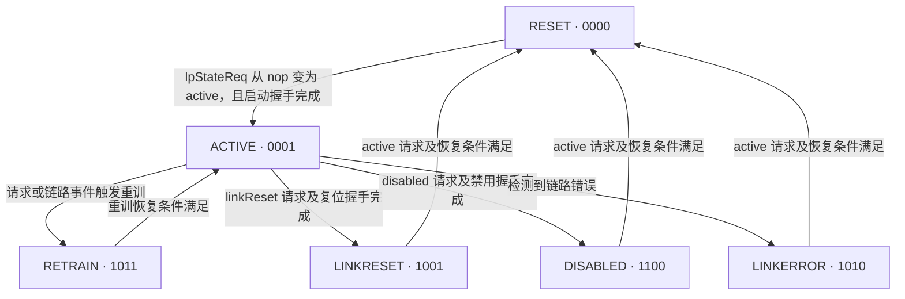

# Types.scala

[Scala 源码](../../../../scala/src/uciedigital/interfaces/Types.scala)

本文件定义 8 个 `ChiselEnum`，为 FDI 和 RDI 的链路配置、协商结果及状态握手提供硬件编码。RDI 位于逻辑 PHY 和 D2D Adapter 之间，FDI 位于 D2D Adapter 和协议层之间。下表只列源码声明的编码。

## SpeedMode

4 位 PHY 速率模式，单位为 GT/s，用于 RDI 和 FDI 的 `plSpeedmode`。

| 成员 | 编码 | 含义 |
| --- | --- | --- |
| `speed4` | `0000` | PHY 速率 4 GT/s。 |
| `speed8` | `0001` | PHY 速率 8 GT/s。 |
| `speed12` | `0010` | PHY 速率 12 GT/s。 |
| `speed16` | `0011` | PHY 速率 16 GT/s。 |
| `speed24` | `0100` | PHY 速率 24 GT/s。 |
| `speed32` | `0101` | PHY 速率 32 GT/s。 |
| `speed48` | `0110` | PHY 速率 48 GT/s。 |
| `speed64` | `0111` | PHY 速率 64 GT/s。 |

## LinkWidth

3 位链路宽度模式，用于 RDI 和 FDI 的 `plLnkCfg`。枚举名称中的数字表示链路宽度配置。

| 成员 | 编码 | 含义 |
| --- | --- | --- |
| `x4` | `000` | 链路宽度 x4。 |
| `x8` | `001` | 链路宽度 x8。 |
| `x16` | `010` | 链路宽度 x16。 |
| `x32` | `011` | 链路宽度 x32。 |
| `x64` | `100` | 链路宽度 x64。 |
| `x128` | `101` | 链路宽度 x128。 |
| `x256` | `110` | 链路宽度 x256。 |

## FDIProtocol

- 4 位协议协商结果，由适配器通过 `plProtocol` 报告。协议层结合 `plProtocolVld` 锁存结果。CXL 后的数字沿用源码对协议类别的编号。
- plProtocol 是链路协商结果。在同一次链路运行期间，即使连续传输多拍或多个事务，协议层也一直使用同一个已锁存的值。
- 只使用了`streamingNoManagementTransport`和``

| 成员 | 编码 | 含义 |
| --- | --- | --- |
| `pcieNoManagementTransport` | `0000` | PCIe，不带 Management Transport。 |
| `cxl1NoManagementTransport` | `0011` | CXL 类别 1，不带 Management Transport。 |
| `cxl2NoManagementTransport` | `0100` | CXL 类别 2，不带 Management Transport。 |
| `cxl3NoManagementTransport` | `0101` | CXL 类别 3，不带 Management Transport。 |
| `cxl4NoManagementTransport` | `0110` | CXL 类别 4，不带 Management Transport。 |
| `streamingNoManagementTransport` | `0111` | Streaming，不带 Management Transport。 |
| `pcieWithManagementTransport` | `1000` | PCIe，带 Management Transport。 |
| `managementTransport` | `1001` | 仅 Management Transport（管理传输）。 |
| `cxl1WithManagementTransport` | `1011` | CXL 类别 1，带 Management Transport。 |
| `cxl2WithManagementTransport` | `1100` | CXL 类别 2，带 Management Transport。 |
| `cxl3WithManagementTransport` | `1101` | CXL 类别 3，带 Management Transport。 |
| `cxl4WithManagementTransport` | `1110` | CXL 类别 4，带 Management Transport。 |
| `streamingWithManagementTransport` | `1111` | Streaming，带 Management Transport。 |

| UCIe 模式 | 启用的子协议 | 通俗理解 |
| --- | --- | --- |
| `cxl1`（CXL.1） | **CXL.io** | 主机可以发现、配置设备，并进行普通 I/O 访问。 |
| `cxl2`（CXL.2） | **CXL.io + CXL.cache** | 对应 **Type 1** 设备。设备可以一致地缓存主机内存，例如网卡或加速器读取主机内存。 |
| `cxl3`（CXL.3） | **CXL.io + CXL.cache + CXL.mem** | 对应 **Type 2** 设备。设备可以一致地缓存主机内存，主机也可以访问设备自带的内存。 |
| `cxl4`（CXL.4） | **CXL.io + CXL.mem** | 对应 **Type 3** 设备。典型例子是内存扩展器，主机可以访问扩展器提供的内存。 |
## FDIFlitFormat

- 4 位已协商的格式，由适配器通过 `plProtocolFlitFmt` 报告。协议类型和格式分别由 `FDIProtocol` 和本枚举表示。
- 按当前仓库的实现，实际链路只使用 `rawFormat`
- `format68B` 出现在独立测试中，用来验证控制器能锁存一个不同于默认值的格式。
- `standard256BEndHeader` ~ `latencyOptimized256BWithOptionalBytes`如果明确将工程限定为 Raw-only，可以考虑删除。


| 成员 | 编码 | 含义 |
| --- | --- | --- |
| `rawFormat` | `0001` | **原样传。** 适配器把协议层的数据直接向下传，无需额外添加 UCIe Flit 头和 CRC。 |
| `format68B` | `0010` | **按 68 字节封装。** 典型布局是 64 字节数据、2 字节头和 2 字节 CRC。 |
| `standard256BEndHeader` | `0011` | **256 字节，头部靠后。** 适配器的 Flit 头放在后段，接收端收到后段时才能读取这部分控制信息。 |
| `standard256BStartHeader` | `0100` | **256 字节，头部靠前。** 接收端可以更早读取控制信息，例如判断数据应交给哪个协议栈。 |
| `latencyOptimized256BNoOptionalBytes` | `0101` | **低延迟布局，无可选字节。** 总长为 256 字节，CRC 分段放置，接收端可以更早校验前面的数据。 |
| `latencyOptimized256BWithOptionalBytes` | `0110` | **低延迟布局，含可选字节。** 总长为 256 字节，协议层可使用 Format 6 规定的额外字节位置来承载数据。 |


## RDIState

4 位 RDI 状态，由逻辑 PHY通过 `plStateSts` 向D2D Adapter报告。

| 成员 | 编码 | 含义 |
| --- | --- | --- |
| `reset` | `0000` | 处于复位状态。 |
| `active` | `0001` | 链路处于活动状态。 |
| `activePmNak` | `0011` | 低功耗请求被拒绝，报告 Active.PMNAK。 |
| `l1` | `0100` | 处于 L1 低功耗状态。 |
| `l2` | `1000` | 处于 L2 低功耗状态。 |
| `linkReset` | `1001` | 处于链路复位状态。 |
| `linkError` | `1010` | 处于链路错误状态。 |
| `retrain` | `1011` | 处于重新训练状态。 |
| `disabled` | `1100` | 链路处于禁用状态。 |

## RDIStateReq

4 位 RDI 状态请求，由D2D Adapter通过 `lpStateReq` 发给逻辑 PHY。

| 成员 | 编码 | 含义 |
| --- | --- | --- |
| `nop` | `0000` | 无状态变更请求。 |
| `active` | `0001` | 请求进入 ACTIVE。 |
| `l1` | `0100` | 请求进入 L1。 |
| `l2` | `1000` | 请求进入 L2。 |
| `linkReset` | `1001` | 请求复位链路。 |
| `retrain` | `1011` | 请求重新训练链路。 |
| `disabled` | `1100` | 请求禁用链路。 |

## FDIState

4 位 FDI 状态，由D2D Adapter通过 `plStateSts` 向协议层报告。

| 成员 | 编码 | 含义 | 与请求或数据路径的关系 |
| --- | --- | --- | --- |
| `reset` | `0000` | 处于复位状态。 | 启动期间，`plInbandPres` 为高时协议层可发出 `active` 请求。协议和格式在协商有效时锁存。 |
| `active` | `0001` | 链路处于活动状态。 | 当前工程打开主带 TX/RX 的链路门控。TX 仍受 stall 和握手控制，RX 采集还要求 `lpRxActiveSts = 1`。 |
| `activePmNak` | `0011` | 低功耗请求被拒绝，报告 Active.PMNAK。 | 用于报告低功耗请求被拒绝。请求枚举无对应项，当前适配器的 FDI 状态更新无进入该状态的分支。 |
| `l1` | `0100` | 处于 L1 低功耗状态。 | 请求枚举有 `l1`，当前协议控制器未发出该请求。 |
| `l2` | `1000` | 处于 L2 低功耗状态。 | 请求枚举有 `l2`，当前协议控制器未发出该请求。 |
| `linkReset` | `1001` | 处于链路复位状态。 | `lpStateReq = linkReset` 可发起链路复位。满足恢复条件后先回到 `reset`，再走启动流程。 |
| `linkError` | `1010` | 处于链路错误状态。 | 由适配器报告链路错误。协议层可发出 `active` 请求，满足恢复条件后适配器回到 `reset`。 |
| `retrain` | `1011` | 处于重新训练状态。 | `lpStateReq = retrain` 可请求重训。重训期间关闭主带链路门控，满足恢复条件后返回 `active`。 |
| `disabled` | `1100` | 链路处于禁用状态。 | `lpStateReq = disabled` 可请求禁用链路。重新启用时先回到 `reset`，再走启动流程。 |

## FDIStateReq

4 位 FDI 状态请求，由协议层通过 `lpStateReq` 发给D2D Adapter。

| 成员 | 编码 | 含义 |
| --- | --- | --- |
| `nop` | `0000` | 无状态变更请求。 |
| `active` | `0001` | 请求进入 ACTIVE。 |
| `l1` | `0100` | 请求进入 L1。 |
| `l2` | `1000` | 请求进入 L2。 |
| `linkReset` | `1001` | 请求复位链路。 |
| `retrain` | `1011` | 请求重新训练链路。 |
| `disabled` | `1100` | 请求禁用链路。 |

## 请求与状态的对应关系

- `lpStateReq` 表达希望执行的操作，`plStateSts` 报告接口当前状态。例如，协议层发出 `FDIStateReq.active` 后，通过 `FDIState.active` 确认适配器已进入 ACTIVE。
- 同一个 `0000` 在请求类型里是 `nop`，在状态类型里是 `reset`。`activePmNak` 和 `linkError` 是状态报告值。
- RDI 和 FDI 的这两组枚举各自采用相同的编码表。适配器分别处理两侧的接口状态，协议层的 FDI 请求和 PHY 的 RDI 状态可以处于不同的推进阶段。

## FDI 两端与状态转换

FDI 两端是协议层和本地 D2D Adapter。Adapter 管理链路，并向协议层报告链路当前状态。

```text
协议层 ── lpStateReq 请求 ──→ D2D Adapter
协议层 ←─ plStateSts 状态 ─── D2D Adapter
```

图中节点是 `plStateSts` 的值，箭头表示当前实现的主要转换条件。协议层刚发出 `lpStateReq = active` 时，`plStateSts` 仍可为 `reset`，等适配器完成启动握手后才更新。



| 转换 | 触发条件 |
| --- | --- |
| `RESET → ACTIVE` | 在 FDI 启动阶段检测到 `lpStateReq` 从 `nop` 变为 `active`，并且适配器完成启动握手。 |
| `ACTIVE → RETRAIN` | 协议层可通过 `lpStateReq = retrain` 请求重训，链路事件也可以触发重训。 |
| `RETRAIN → ACTIVE` | 适配器判断重训恢复条件已满足。 |
| `ACTIVE → LINKRESET / DISABLED` | `lpStateReq = linkReset / disabled` 可发起对应流程。适配器在相关握手完成后更新状态。 |
| `ACTIVE → LINKERROR` | 适配器检测到链路错误，使用 `plStateSts` 报告。 |
| `LINKRESET / DISABLED / LINKERROR → RESET` | `lpStateReq = active` 参与恢复。恢复条件满足后先回 `RESET`，再走启动流程。 |

[AdapterSM 源码](../../../../scala/src/uciedigital/d2dadapter/AdapterSM.scala)
