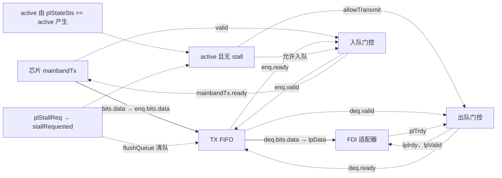
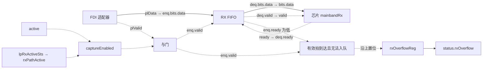
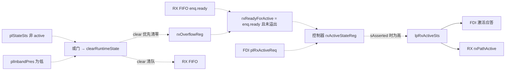

# ProtocolLayer.scala

[Scala 源码](../../../../scala/src/uciedigital/protocol/ProtocolLayer.scala)

`ProtocolLayer` 连接芯片侧的原始主带接口和适配器侧的 FDI。顶层实例化 TX、RX、状态控制器和边带通道，并将各模块的握手及状态接到对应端口。默认 FDI 主带每拍 64 字节，`ncWidth` 参数为 32，TX 和 RX FIFO 均为 2 拍。

## 主带数据通路

图中实线传递数据或直接连接端口，虚线传递握手和控制条件。`enq` 是 FIFO 写入口，`deq` 是读出口。任一侧在该侧 `valid && ready` 的时钟沿传输一拍。

### TX：芯片写入，FDI 取走

| 观察点 | RTL 条件 |
| --- | --- |
| 芯片能交付一拍 | `ingressBlocked = stallRequested ∨ ¬active`。因此 `mainbandTx.ready = enq.ready ∧ ¬ingressBlocked`，`enq.valid = mainbandTx.valid ∧ ¬ingressBlocked`。 |
| FDI 能取走队首 | `lpIrdy = lpValid = deq.valid ∧ allowTransmit`，`deq.ready = plTrdy ∧ allowTransmit`。当 `plTrdy = 0` 时队首保留。 |
| 停顿得到确认 | `txIdle = ¬deq.valid ∨ flushQueue`。即使原先有数据，拉高 `plStallReq` 也会当拍停止发送并报告空闲。控制器在时钟沿置位 `stallAckReg`，随后 `lpStallAck` 与 `status.stalled` 同时为高。 |

### RX：FDI 送入，芯片取走

`captureEnabled = active ∧ rxPathActive`。以默认两拍深度为例，FIFO 已满且 FDI 送来有效拍 C 时，`mainbandRx.ready = 1` 允许芯片取走队首。由于 `pipe = true`，FIFO 同拍也能接收 C。若此时 `mainbandRx.ready = 0`，C 丢失并置位溢出寄存器。此例假定接收已激活且复位、清除均无效。

### RX 激活、溢出反馈和清除

从 `sIdle` 开始，请求持续为高时先进入 `sWaitAssert`，采样到 `rxReadyForActive = 1` 后才进入 `sAsserted` 并拉高应答。已经处于 `sAsserted` 时，FIFO 变满会拉低激活就绪，应答仍保持到状态机采样到请求撤销。因此 `rxReadyForActive` 参与激活握手，FDI 发送每个 `plValid` 拍时没有对应的逐拍 ready。

## 顶层连线

| 子模块 | 输入、输出及反馈 |
| --- | --- |
| [ProtocolMainbandTx](ProtocolMainbandTx.scala-rtldoc.md) | 芯片侧 `mainbandTx` 入队，FDI 的 `plTrdy` 控制发送握手，TX 输出 `lpIrdy/lpValid/lpData`。FDI 的 `plStallReq` 直连 TX，TX 返回 `txIdle` 给状态控制器。 |
| [ProtocolMainbandRx](ProtocolMainbandRx.scala-rtldoc.md) | 从 FDI 接收 `plValid/plData`，FIFO 出队接到芯片侧 `mainbandRx`。控制器提供 `lpRxActiveSts` 和 `clearRuntimeState`，RX 返回 `rxReadyForActive` 给控制器，并将 `rxOverflow` 送至顶层状态端口。 |
| [ProtocolStateController](ProtocolStateController.scala-rtldoc.md) | 接收芯片侧 `ctrl`、FDI 链路状态和握手请求，驱动 `lpStateReq`、`lpLinkError`、`lpStallAck`、`lpWakeReq`、`lpClkAck` 和 `lpRxActiveSts`。顶层其余状态字段来自这里。 |
| `ProtocolSidebandChannel` | FDI 侧通过 `plCfg/plCfgVld` 和 `lpCfg/lpCfgVld` 双向传数据，分别以 `lpCfgCrd` 和 `plCfgCrd` 返回相应方向的信用。通道宽度和信用参数来自 `fdiParams` 与 `sbParams`。 |

两个主带模块的 `active` 都由 `plStateSts === FDIState.active` 生成。RX 采集还要求控制器已拉高 `lpRxActiveSts`。例如，适配器提出 `plRxActiveReq` 后，控制器确认 `rxReadyForActive` 才进入应答状态。随后两项接收条件均满足时，FDI 的有效拍可以入 RX FIFO。

## 跨模块信号关系

| 类别 | 信号链 | 对数据或状态的影响 |
| --- | --- | --- |
| 主带发送 | `mainbandTx.valid/bits/ready` → TX FIFO → `lpIrdy/lpValid/lpData`，`plTrdy` 反馈给 TX | FDI 暂停接收会积压队列。队列无法入队时，芯片侧的 `mainbandTx.ready` 拉低。 |
| 主带接收 | `plValid/plData` → RX FIFO → `mainbandRx.valid/bits/ready` | 芯片侧暂停会积压队列。FDI 继续送拍且无可用位置时，`status.rxOverflow` 置位。 |
| 链路门控 | `plStateSts` → TX/RX 的 `active`，同时送控制器 | ACTIVE 允许 TX 握手，并作为 RX 采集的必要条件。控制器也用链路状态限制激活请求和生成 RX 清除。 |
| 接收激活 | `plRxActiveReq` + `rxReadyForActive` → 控制器 → `lpRxActiveSts` | 应答同时送回适配器和 RX，RX 用它驱动 `rxPathActive`。 |
| 发送停顿 | `plStallReq` → TX 清队并报告 `txIdle` → 控制器登记 `lpStallAck` | FDI 收到停顿应答，芯片侧可通过 `status.stalled` 读取同一状态。 |
| 运行状态清除 | `plInbandPres`、`plStateSts` → `clearRuntimeState` → RX 的 `clear` | 清除 RX 积压和溢出状态，影响后续 RX 激活就绪。 |
| 边带接收 | `plCfg/plCfgVld` → 边带通道；`lpCfgCrd` 返回适配器 | 数据和有效位进入通道，信用由通道返回给该方向的发送方。 |
| 边带发送 | 边带通道 → `lpCfg/lpCfgVld`；`plCfgCrd` 返回通道 | 适配器返回的信用交给通道的发送侧。当前芯片侧边带输入固定为无效。 |

## 边带和 RTL 生成入口

当前顶层没有向芯片侧提供边带消息端口。`sidebandChannel.io.layer.in.valid` 固定为低，`layer.in.bits` 为零，`layer.out.ready` 固定为高，因此到达协议层输出的边带消息会被消费。

`MainProtocolLayer` 通过 `ChiselStage.emitSystemVerilogFile` 展开默认配置，将 SystemVerilog 写到相对于运行目录的 `generatedVerilog/protocol`，并传入源码中列出的 firtool 选项。
